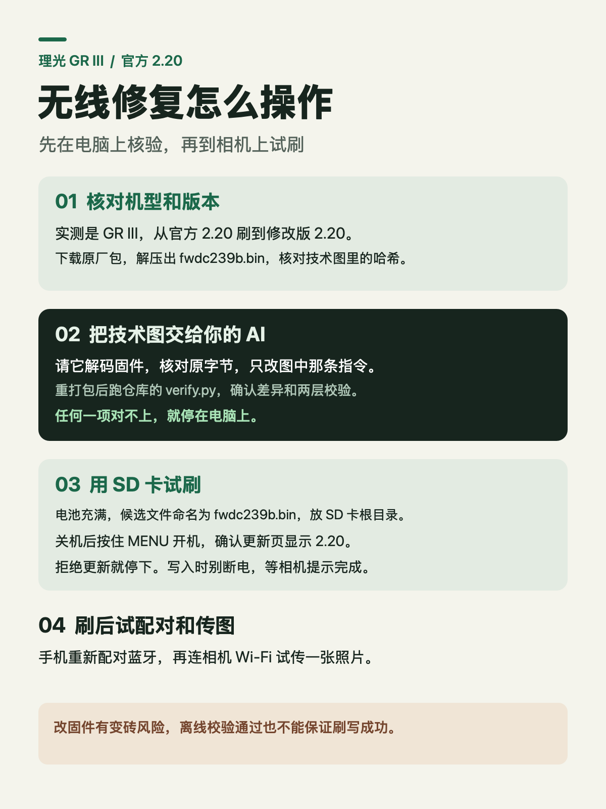

# Ricoh GR III 2.20 蓝牙与 Wi-Fi 修复记录

我的 GR III 在一次固件升级后先是蓝牙配不上，后来发现 Wi-Fi 菜单能选「打开」，但图标仍灰，手机和 Mac 都搜不到热点。长按回放键也没有启动热点。最早出问题时的固件版本记不清，可能是 1.91 或 2.00。官方 2.20 仍有同样症状。

**单台实测结果**

GR III 从官方 2.20 刷到基于同版原厂镜像制作的修改版 2.20 后，无线功能恢复。改动让固件对机身调整数据的这一项检查通过。为什么原来过不了，仍待查证。

## 从哪里开始

| 要做什么 | 看哪里 |
| --- | --- |
| 对照症状、版本和试刷流程 | [机友操作指南](docs/camera-workflow.md) |
| 核对原厂文件、指令位置、重打包和校验 | [电脑端复现记录](docs/reproduction.md) |
| 把任务交给能操作本地文件的 AI | [AI 执行清单](docs/ai-handoff.md) |
| 查看为什么标记会触发禁用 | [未解决的问题](docs/open-question.md) |
| 对照手里的候选文件 | [只读校验脚本](verify.py) |

仓库内无固件 BIN。原厂固件通过理光官网获取。刷写修改版固件可能导致相机无法开机，离线校验通过也无法保证更新或修复成功。

## 来源

- [理光 GR III 更新步骤与固件许可](https://www.ricoh-imaging.co.jp/english/support/digital/gr3_s.html)
- [社区 GR III 2.10 实机日志记录](https://github.com/idontknownihil/gr3-film-mods/blob/main/FINDINGS.md#22a-camera-result-factory-mode-2026-10-08-entry-works-on-gr-iii-210)
- [gr-custom-tool 容器解析器](https://github.com/DoYitNow/gr-custom-tool)。使用者按复现指南另行获取固定版本。
- 单指令改动的思路来自一位机友分享的 2.10 反汇编截图。2.20 的位置和字节由原厂镜像重新核对。
