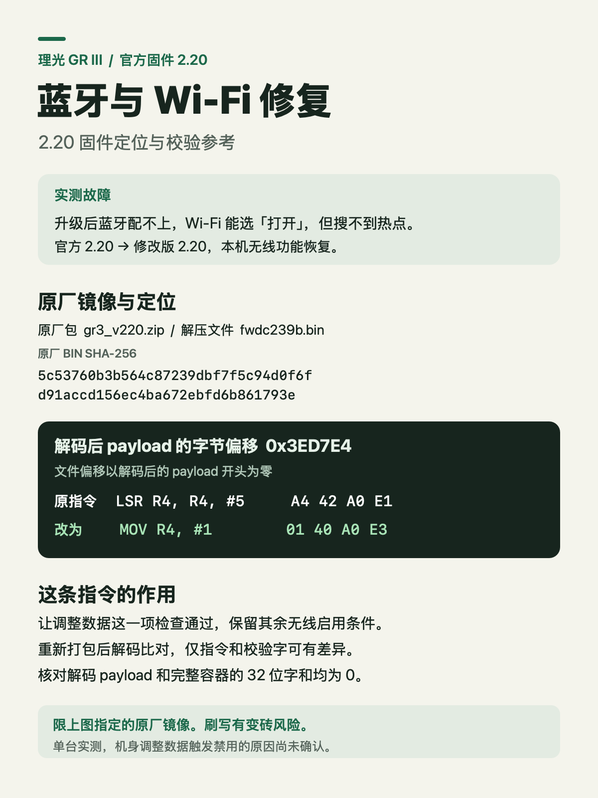

# 在电脑上复现 GR III 2.20 的无线补丁

## 原厂输入和唯一改动

- 机型为 **GR III**，实测起始版本为**官方 2.20**。
- 下载 [理光官方 gr3_v220.zip](https://www.ricoh-imaging.co.jp/resources/japan/support/download/digital/FIRMWARE/gr3_v220.zip)，解压得到 `fwdc239b.bin`，大小为 30,472,516 字节。
- 原厂 BIN SHA-256 为 `5c53760b3b564c87239dbf7f5c94d0f6fd91accd156ec4ba672ebfd6b861793e`。
- 用下文的容器解析器读出 payload 边界和解码大小。对完整 payload 解码。偏移 **0x3ED7E4** 从解码结果的第一个字节起算，位于 RTOS 段内。
- 偏移前 8 字节开始的上下文如下，在指定原厂镜像解码结果中唯一。只替换方括号内四字节。

```text
B4 00 D3 E1 10 4F 6F E1 [A4 42 A0 E1] 00 00 54 E3 07 00 00 1A
LSR R4, R4, #5 → MOV R4, #1
A4 42 A0 E1    → 01 40 A0 E3
```



## 重打包和验证

1. 保留原厂解码段布局，更新解码 payload 末尾校验字，使小端 32 位字和模 2³² 为零。
2. 用原厂容器作模板重打包。实测文件尽可能复用原厂压缩帧。对不能解码出目标字节的帧，用同一编解码器允许的 literal 帧编码，再更新容器长度与末尾校验字。实测文件替换了两个帧。
3. 对生成的文件重新解码。逐字节核对解码结果只在该指令和末尾校验字处有差异。完整容器和解码 payload 的 32 位字和都应为零。
4. 实测文件 SHA-256 为 `c413032dff1a2b390a1baef7dbbc936eea184c8d66d1274f44327a32de6c942c`。不同的帧编码可能产生不同的外层文件哈希，下面的校验工具比较解码后的内容。

### 给 AI 的容器处理细节

- `inspect_container(stock)` 提供 `payload_end` 和 `decoded_size`。把 `stock[128:payload_end]` 交给 `decode_payload`，得到完整的解码字节与帧坐标。别把 RTOS 段单独切出来后再使用上面的偏移。
- 重包时，对每个原始帧，使用**已修改的前序解码字节**尝试解码该帧，确认结果仍等于目标片段再复用原始编码。压缩回引用可以跨帧，单看当前帧覆盖范围不足以判断是否能复用。实测中替换的片段使用不超过 `0x6000` 字节的 literal 帧。
- 保留流结束标记和原厂容器头，用解析器的 `framed_container` 处理对齐、容器尾部长度及整包校验。最后从生成的 BIN 重新解码再运行校验。
- 如果 AI 只能在聊天窗口读图、无法实际运行二进制解码和比对，就让它先给出本地操作方案。实际校验需要在能读取两个 BIN 的电脑上执行。

## 在电脑上只读核验

使用 Python 3 和公开的 [gr-custom-tool](https://github.com/DoYitNow/gr-custom-tool) 容器解析器。本仓库的校验脚本只读取输入文件，解析器由使用者另行获取。

```sh
git clone https://github.com/DoYitNow/gr-custom-tool.git
git -C gr-custom-tool checkout 258d745aab8691fbbeb4a68b024be9a24333c9ea
python3 verify.py --codec ./gr-custom-tool /path/to/stock.bin /path/to/candidate.bin
```

可以把本页、两张图和自己下载的原厂 BIN 交给 AI，要求它先核对原厂哈希及指令上下文，再生成候选并运行上述校验。任一检查失败就停在电脑上。相机拒绝更新时停下，记录提示。

## 核验输出怎么读

- `PASS` 表示候选通过脚本列出的离线检查。候选哈希与实测文件相同，表示文件逐字节相同。哈希不同时，可以对照具体容器差异，不能把候选称为实测文件。
- `FAIL` 或异常表示核验未通过。保留原厂输入，查看失败原因，修正后再跑。没有实际运行工具时，结果记为未核验。
- 这份记录只涵盖文中 SHA-256 对应的 GR III 2.20 原厂镜像。其他机型、固件版本和从其他版本刷入的情况未验证。
